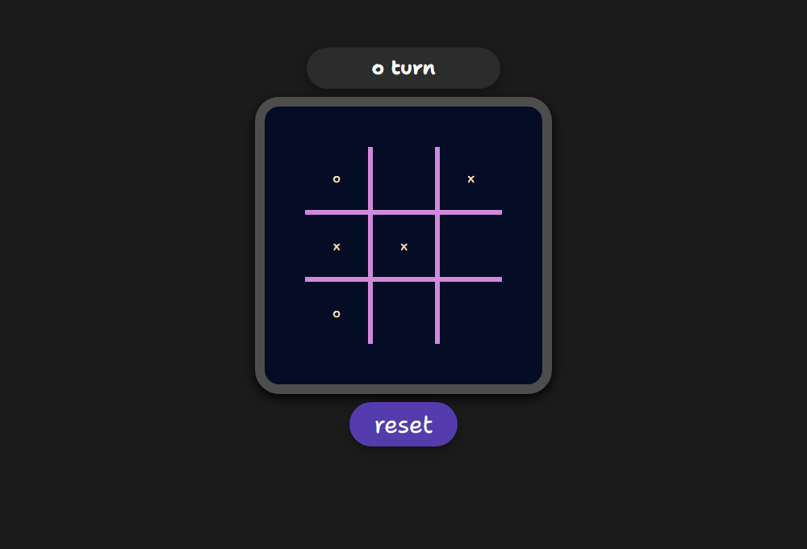

# Tic-Tac-Toe

A two-player tic-tac-toe game in plain JavaScript, HTML and CSS.


> **Type:** learning project for DOM events and game-state logic.



## Features

- Two players take turns as **x** and **o**; the current turn is shown above the board.
- Squares that are already taken can't be played again.
- Detects wins on all rows, columns and diagonals, and detects a draw.
- Shows the result in a dialog (alertify.js).
- **Reset** button to start a new game.

## How It Works

The board is stored as an array of nine values. After each move, `evaluateBoard()` compares the eight possible winning lines; if no line is complete and no empty square remains, the game is a draw.

## Project Structure

```text
x-o/
├── index.html   # board layout
├── style.css    # styles
├── logic.js     # turns, win/draw detection, reset
└── docs/screenshot.png
```

## How to Run

No build step. Clone the repository and open `index.html` in a browser:

```bash
git clone https://github.com/Re7absu/x-o.git
```

alertify.js and the fonts load from a CDN, so an internet connection is needed.

## Future Improvements

- Highlight the winning line.
- Keep a score across rounds.
- Add a single-player mode against a simple computer opponent.

## License

Released under the [MIT License](LICENSE).
